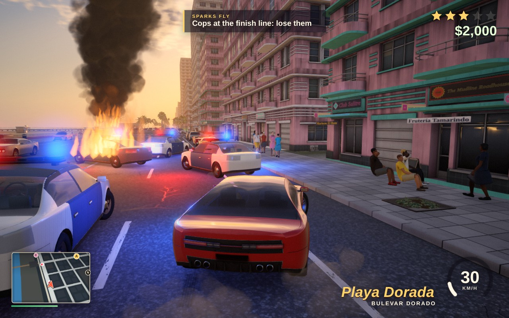
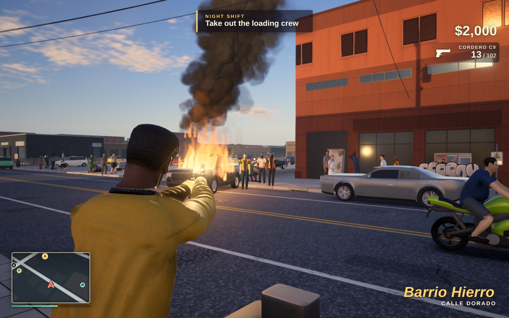
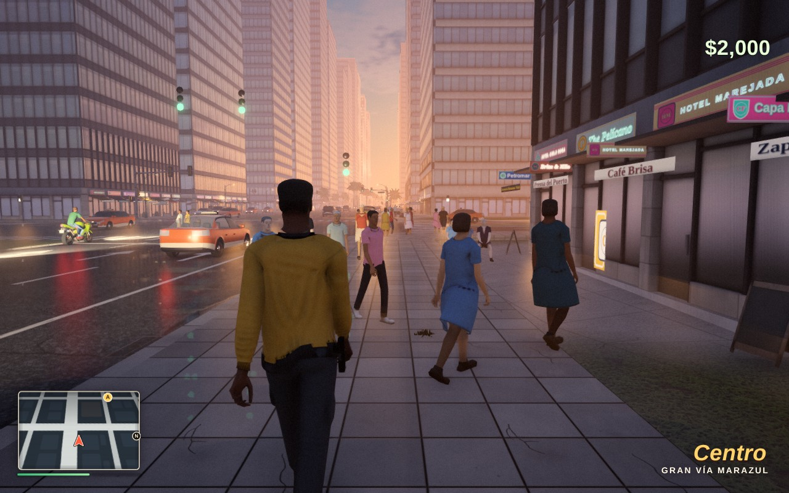
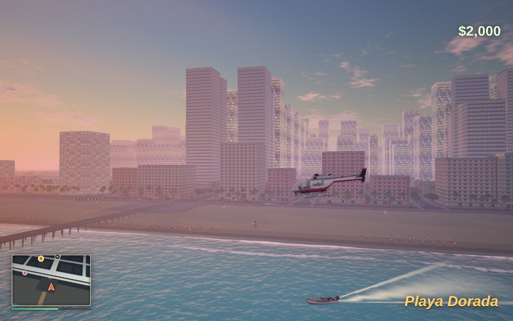

# MARAZUL

   

**MARAZUL** is an original 3D open-world crime game for desktop browsers, set in Marazul, an invented, sun-soaked Gulf-coast city of pastel deco beach hotels, a glass downtown, an old town, a container port, rail yards and hillside villas. You walk its streets, take any car you can open, drive through living traffic, pick fights you may regret, and work your way up through a story of gold smuggled through the port as bathroom tiles.

Two leads share the story: **Dez Tolliver**, a tow driver whose family garage is being foreclosed on, and **Sol Arrieta**, the customs inspector who was fired for weighing the wrong container. Both find the same name on their paperwork: Don Aurelio Santángel, owner of the casino and, quietly, of the waterfront.

Entered in the make.fun bounty `gta6-01`.

## Screenshots

The four judged pictures, real renders of the game's own code (`tools/take-screenshots.mjs` with the scenes listed in `shots.json`):

| | |
|---|---|
|  |  |
| **Cover:** a golden-hour police chase past a burning wreck, wanted stars and minimap on the HUD | **Mission firefight** in the worn streets of Barrio Hierro, from the over-the-shoulder aim camera |
|  |  |
| **Dusk on foot** with traffic and pedestrians | **The skyline from the sea** at sunset |

## Play it

The game is plain static files under `game/`: no build step, no install, no network request. Serve `game/` with any static HTTP server and open it in desktop Chrome:

```sh
node serve.ts            # serves game/ on http://localhost:8080 (Node 22.18 or later)
# or any other static server, for example:
python3 -m http.server 8080 --directory game
```

Opening `game/index.html` straight from the disk (`file://`) does not work, because browsers refuse ES modules there. A WebGL2-capable graphics card is needed; the graphics quality can be changed in Settings, and **F3** shows the frame-rate overlay.

## Controls

Keyboard and mouse. Click the game to capture the mouse; the mouse turns the camera.

**On foot**

| Key | Action |
|---|---|
| W A S D / arrow keys | Move |
| Shift | Sprint |
| Left Alt (hold) | Walk |
| Space | Jump / climb |
| C | Crouch |
| F or Enter | Enter a vehicle (take it, if it is not yours) |
| E | Interact, talk, start a mission at its marker |
| Right mouse (hold) | Aim (over-the-shoulder camera) |
| Left mouse | Fire / punch / swing / throw |
| R | Reload |
| Mouse wheel, X / Z | Next / previous weapon |
| 1 to 8 | Weapon slot |
| Tab (hold) | Weapon wheel |
| Q | Holster the weapon |

**In a vehicle**

| Key | Action |
|---|---|
| W / S (or arrow keys) | Accelerate / brake and reverse |
| A / D | Steer |
| Space | Handbrake |
| F or Enter | Leave the vehicle |
| H | Horn (siren in emergency vehicles) |
| L | Headlights |
| E / Q, mouse wheel | Next / previous radio station |
| Left mouse | Fire from the window |
| C | Look behind |
| V | Near or far chase camera |

**Anywhere**

| Key | Action |
|---|---|
| M | City map (WASD to pan, wheel to zoom, click to set a waypoint) |
| T | Phone |
| Esc or P | Pause menu |
| Enter or Space | Skip a cutscene |
| F3 | Performance overlay |

The start menu offers Continue, New game, Load game, Settings and Controls; the pause menu adds Resume, Statistics and Save game. Menus work with the mouse or with the arrow keys, Enter and Backspace.

## What is in it

Each system is one folder under `game/src/`, registered in `game/src/core/systems/gameSystemManifest.js` and described in `docs/ARCHITECTURE.md`.

- **The city** (`world/`, `render/`): a streamed open world generated from a city plan of districts, roads, intersections, lots and lanes (`docs/CITY_PLAN.md`), dressed with Blender-built building kits (deco resort, glass towers, downtown commercial, barrio low-rise, residential villas), street lamps, signals, palms and trees in proper tree pits, kerb clutter, port cranes and beach furniture. A day-night clock with golden hour, physical sky, water, wet streets after rain, and weather from clear to storm.
- **On foot** (`player/`, `characters/`): rigged, skinned characters with blended walk, run and sprint, a close cinematic third-person camera with a damped follow, and an over-the-shoulder aim view with trained shooting stances per weapon class.
- **Vehicles** (`vehicles/`, `physics/`): sports cars, sedans, hatchbacks, SUVs, a taxi, a muscle car, a supercar, a convertible, a motorcycle, emergency vehicles, with our own vehicle physics, damage, broken glass and burning wrecks.
- **Traffic and pedestrians** (`traffic/`, `pedestrians/`): lane-following traffic with signals, yielding to sirens and parked cars that pull out; crowds that walk, sit, keep their distance and react to guns; gang territories with their own crews.
- **Police and the wanted level** (`police/`): crimes seen by witnesses add heat; stars bring patrol cars, pursuit SUVs, a helicopter with a searchlight and SWAT; lose them by breaking line of sight until the search ends.
- **Combat** (`combat/`, `effects/`): handguns, an SMG, a shotgun, rifles, a sniper scope, rockets, grenades and melee, with recoil, tracers, casings, muzzle flash, smoke, fire and explosions.
- **Missions and story** (`missions/`): story missions run by a mission director from objective scripts (tows, tails, stealth, races, shootouts, defences, chases) with mission givers, cutscenes, phone calls and checkpoints.
- **Interface** (`ui/`): HUD with a tilted landscape minimap and GPS route, wanted stars, health and armour strip, cash, weapon card, mission objective, speedometer, district banner and subtitles; a full city map, a phone and a weapon wheel.
- **Economy and saving** (`economy/`, `save/`): money, shops, progression and statistics; save slots in the browser.
- **Sound** (`audio/`): every sound synthesised at run time with WebAudio: engines, sirens, weapons, footsteps, city ambience and radio stations with their own composed songs.

## How it is made

- **Engine:** our own game engine and systems in plain ES modules on top of [three.js](https://threejs.org) r185, vendored as its minified builds under `game/vendor/three/`, with the Draco decoder for compressed geometry. No other library.
- **Art:** every model (people, vehicles, building parts, props, plants, weapons) is modelled by our own Python scripts in Blender (`art/`), baked (ambient occlusion, normal maps, procedural materials baked to textures) and shipped as Draco-compressed `.glb` files under `game/assets/`. Terrain, roads, facade and sign textures, the interface and all audio are generated at run time.
- **Tests and tools:** Node tests under `tools/tests/` (`node --test "tools/tests/<area>/*.test.mjs"`), a headless smoke test (`tools/smoke-game.mjs`), preview pages under `tools/preview/`.
- **Hand-in:** `main.ts` copies `game/` and `screenshots/` to the output and writes the dossier with the kit's library; `node tools/release/checkEntry.mjs` re-checks the result against the competition's rules offline:

```sh
mkdir -p out && MAKEFUN_OUTPUT_DIR=out node main.ts
node tools/release/checkEntry.mjs
```

## Originality

MARAZUL is original work. The city, its districts and streets, the characters, factions, brands, story, dialogue, vehicles, art, interface, sounds and music were made for this game. Nothing is taken from Grand Theft Auto or any other commercial game: no names, logos, characters, maps, art, screen texts, music or assets.

## Credits

Designed and built by a team of AI coding agents (Claude) for the make.fun `gta6-01` bounty. Uses [three.js](https://github.com/mrdoob/three.js) (MIT) and the [Draco](https://github.com/google/draco) decoder (Apache-2.0). MARAZUL itself is released under the MIT license (see `LICENSE`).
