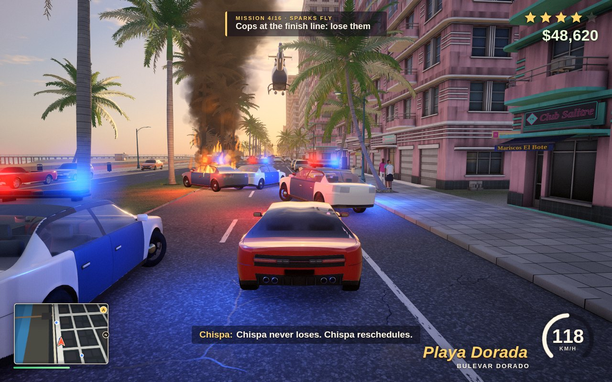
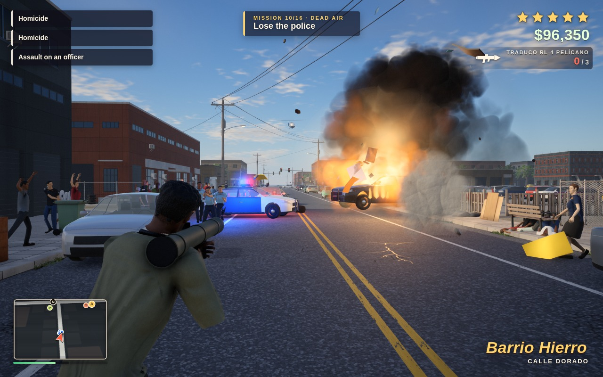
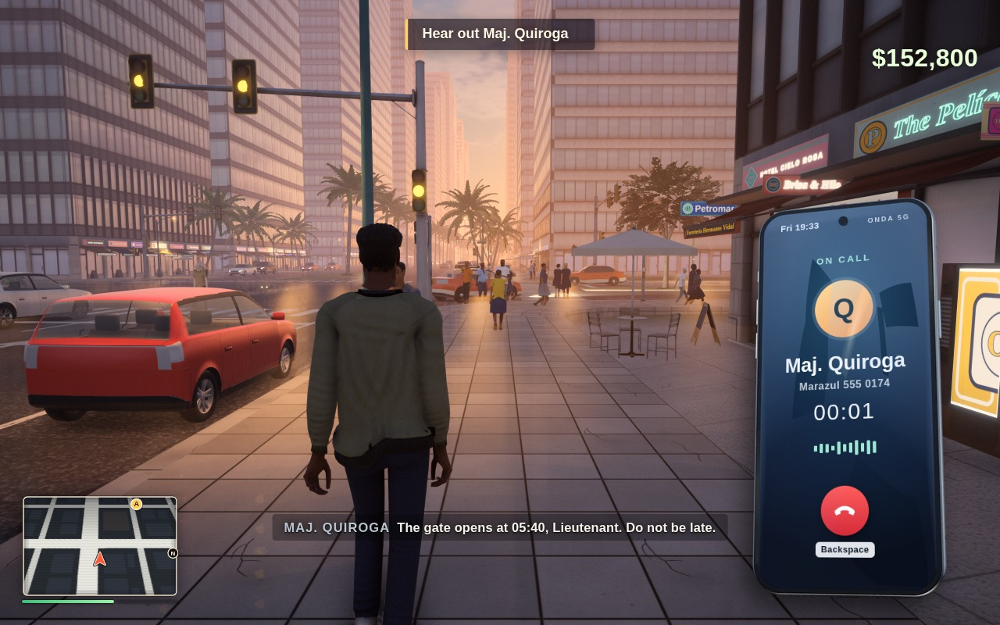
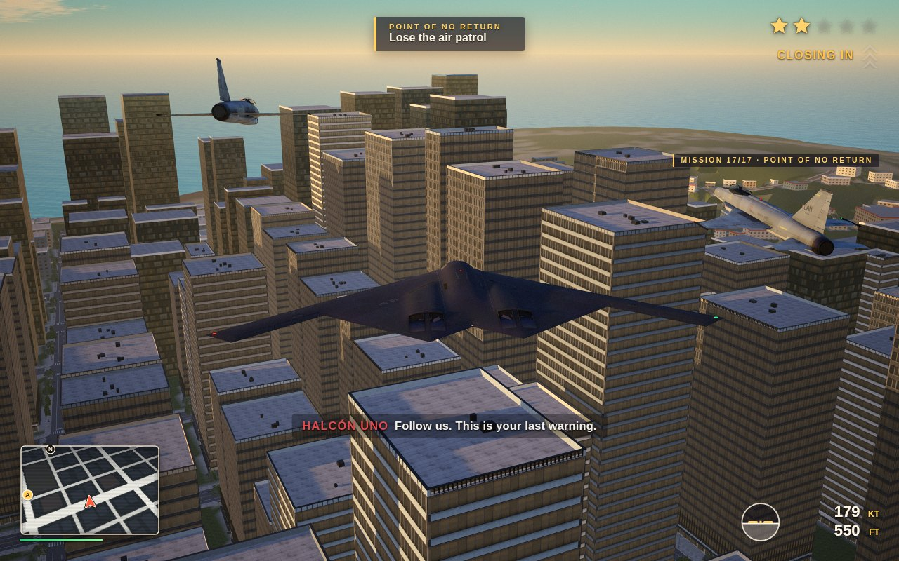

# MARAZUL
[](https://make.fun/bounty/gta6-01?utm_source=github&utm_medium=readme&utm_campaign=gta6-01) [](https://make.fun/bounty/gta6-01/leaderboard?utm_source=github&utm_medium=readme&utm_campaign=gta6-01) [](https://make.fun/bounty/gta6-01?utm_source=github&utm_medium=readme&utm_campaign=gta6-01)


   

**MARAZUL** is an original 3D open-world crime game for desktop browsers, set in Marazul, an invented, sun-soaked Gulf-coast city of pastel deco beach hotels, a glass downtown, an old town, a container port, rail yards and hillside villas. You walk its streets, take any car, boat, helicopter or aircraft you can open, drive through living traffic with the police and their helicopters on your tail, and play through a voiced story of **17 missions**, on foot, by car, by boat and in the air.

Two leads share the story: **Dez Tolliver**, a tow driver and former military pilot whose family garage is being foreclosed on, and **Sol Arrieta**, the customs inspector who was fired for weighing the wrong container. Both find the same name on their paperwork: Don Aurelio Santángel, owner of the casino and, quietly, of the waterfront. Sixteen missions take them from a repossessed car to the court; the seventeenth, **Point of No Return**, is Dez's alone: a forged pass, a dawn walk across an air base, and a stolen aircraft flown from its cockpit past the air patrol.

Entered in the make.fun bounty [`gta6-01`](https://make.fun/bounty/gta6-01).

## Screenshots

The four judged pictures, real renders of the game's own code (`tools/take-screenshots.mjs` with the scenes listed in `shots.json`):

| | |
|---|---|
|  |  |
| **Cover:** a golden-hour police chase through the city, the police helicopter overhead, wanted stars, minimap and objective on the HUD | **Barrio Hierro:** a rocket hits a police roadblock, the cruisers react |
|  |  |
| **Dusk on foot** among traffic and pedestrians, the phone ringing with the call that starts the last job | **The heist:** the stolen Manta Sombra low over Marazul at dawn, the air patrol and a police helicopter ordering it down |

## Play it

The game is plain static files under `game/`: no build step, no install, no network request. Serve `game/` with any static HTTP server and open it in desktop Chrome:

```sh
node serve.ts            # serves game/ on http://localhost:8080 (Node 22.18 or later)
# or any other static server, for example:
python3 -m http.server 8080 --directory game
```

Opening `game/index.html` straight from the disk (`file://`) does not work, because browsers refuse ES modules there. A WebGL2-capable graphics card is needed; the graphics quality can be changed in Settings, and **F3** shows the frame-rate overlay.

## Controls

Keyboard and mouse. Click the game to capture the mouse; the mouse turns the camera.

**On foot**

| Key | Action |
|---|---|
| W A S D / arrow keys | Move |
| Shift | Sprint |
| Left Alt (hold) | Walk |
| Space | Jump / climb |
| C | Crouch |
| F or Enter | Enter a vehicle (take it, if it is not yours) |
| E | Interact, talk, start a mission at its marker |
| Right mouse (hold) | Aim (over-the-shoulder camera) |
| Left mouse | Fire / punch / swing / throw |
| R | Reload |
| Mouse wheel, X / Z | Next / previous weapon |
| 1 to 8 | Weapon slot |
| Tab (hold) | Weapon wheel |
| Q | Holster the weapon |

**In a vehicle**

| Key | Action |
|---|---|
| W / S (or arrow keys) | Accelerate / brake and reverse |
| A / D | Steer |
| Space | Handbrake (helicopter: climb) |
| Left Shift or Left Ctrl | Helicopter: descend |
| W / S, A / D (helicopter) | Fly forward / slow down, turn |
| F or Enter | Leave the vehicle (a helicopter lands first) |
| H | Horn (siren in emergency vehicles) |
| L | Headlights |
| E / Q, mouse wheel | Next / previous radio station |
| Left mouse | Fire from the window |
| C | Look behind |
| V | Near or far chase camera |

**Anywhere**

| Key | Action |
|---|---|
| M | City map (WASD to pan, wheel to zoom, click to set a waypoint) |
| T | Phone |
| Esc or P | Pause menu |
| Enter or Space | Skip a cutscene |
| F3 | Performance overlay |

The start menu offers Continue, New game, Load game, Settings and Controls; the pause menu adds Resume, Statistics and Save game. Menus work with the mouse or with the arrow keys, Enter and Backspace.

## Flight

Four original fixed-wing aircraft fly on a real flight model. A **Golfo Aero Gaviota T-2** trainer is parked beside the runway of Aeródromo Los Pantanos: walk up, press F, and it is yours.

| Aircraft | What it is | Numbers |
| --- | --- | --- |
| Gaviota T-2 | two-seat high-wing piston trainer, six-instrument cockpit | 8.6 m span, 760 kg, stalls at 48 kt clean and 42 kt with flaps, cruises near 100 kt, takes off in about 220 m |
| Manta Sombra | black flying-wing stealth aircraft with straight, sharp edges, glass cockpit with four displays, belly hatch and ladder | 46 m span, Mach 0.85, 15 km ceiling |
| Garza Negra | long black high-altitude jet, analog cockpit of round gauges | 31 m long, Mach 3 at 24 km, skin near 300 °C there |
| Halcón | interceptor of the Marazul Air Guard (exterior only) | Mach 1.8 |

**The flight model** (`game/src/flight/`, `game/src/physics/aircraft/Airplane.js`): lift ½ρv²·S·C<sub>L</sub>(α) with a stall break, parasitic, induced and wave drag, piston and jet thrust with altitude lapse and afterburner, weight, flaps, elevator trim, the standard atmosphere to 30 km, ground effect, a ground roll on three sprung wheels with brakes and nose-wheel steering, crosswind, stall warning and buffet, hard landings and crashes.

**Two modes** (Settings, "Flight mode"): **Casual** (the default: auto-trim, stall protection, bank limit, self-levelling when the stick is released, coordinated turns) and **Realistic** (the raw model: it stalls, drops a wing, needs trim, flaps and rudder).

**Autopilot**: HDG, ALT, VS and NAV (it follows the GPS route to the waypoint on the map), with auto-throttle on the jets. It will not engage on the ground and lets go on a firm stick input or a stall.

**Cockpits and HUD**: every flight starts in the **cockpit view**, from the pilot's eye with Dez's gloved hands on the stick and throttles, the live displays and the combiner glass; C or V switches to a close chase camera or a free outside view, and the story cuts to short exterior shots at key moments. Each cockpit (Manta Sombra glass cockpit, Garza Negra round gauges, Gaviota six-pack) is its own Blender model; every needle and display reads the flight state. The flight HUD shows a pitch ladder, airspeed, altitude, heading and vertical-speed tapes, Mach and G, the autopilot line and STALL, PULL UP, OVERSPEED and GEAR warnings.

| Key | In an aircraft |
| --- | --- |
| W / S | Stick forward (nose down) / back (nose up) |
| A / D | Roll left / right |
| Q / E | Rudder left / right |
| Left Shift / Left Ctrl | Throttle up / down (the lever stays where it is put) |
| F or X | Flaps, one notch (F leaves the aircraft when it stands still on the ground) |
| T + W / S | Trim (realistic mode) |
| G | Landing gear |
| B or Space | Wheel brakes |
| P | Autopilot on / off (Escape pauses) |
| 1 2 3 4 5 | Autopilot HDG, ALT, VS, NAV, auto-throttle |
| ← → / PageUp PageDown | Heading bug / altitude or vertical-speed target |
| C or V | Camera: chase, cockpit, outside |

To try one without walking to it: `index.html?autostart=1&aircraft=gaviota_t2` (or `manta_sombra`, `garza_negra`, `halcon`) starts on the runway; add `&air=600` to start in flight at that height, `&flightview=cockpit` and `&flightmode=realistic` to choose the view and the mode. The aircraft are built by the Blender scripts under `art/blender/aircraft/` (`art/build_aircraft.py`); the flight tests run with `node --test "tools/tests/flight/*.test.mjs"`.

## What is in it

Each system is one folder under `game/src/`, registered in `game/src/core/systems/gameSystemManifest.js` and described in `docs/ARCHITECTURE.md`.

- **The city** (`world/`, `render/`): a streamed open world generated from a city plan of districts, roads, intersections, lots and lanes (`docs/CITY_PLAN.md`), dressed with Blender-built building kits (deco resort, glass towers, downtown commercial, barrio low-rise, residential villas), street lamps, signals, palms and trees in proper tree pits, kerb clutter, port cranes and beach furniture. A day-night clock with golden hour, physical sky, water, wet streets after rain, and weather from clear to storm.
- **On foot** (`player/`, `characters/`): rigged, skinned characters with blended walk, run and sprint, a close cinematic third-person camera with a damped follow, and an over-the-shoulder aim view with trained shooting stances per weapon class.
- **Vehicles** (`vehicles/`, `physics/`): sports cars, sedans, hatchbacks, SUVs, a taxi, a muscle car, a supercar, a convertible, a motorcycle, emergency vehicles, speedboats and helicopters you can take and pilot, with our own vehicle physics, damage, broken glass and burning wrecks.
- **Traffic and pedestrians** (`traffic/`, `pedestrians/`): lane-following traffic with signals, yielding to sirens and parked cars that pull out; crowds that walk, sit, keep their distance and react to guns; gang territories with their own crews.
- **Police and the wanted level** (`police/`): crimes seen by witnesses add heat; stars bring patrol cars, pursuit SUVs, a helicopter with a searchlight and SWAT; lose them by breaking line of sight until the search ends.
- **Combat** (`combat/`, `effects/`): handguns, an SMG, a shotgun, rifles, a sniper scope, rockets, grenades and melee, with recoil, tracers, casings, muzzle flash, smoke, fire and explosions.
- **Missions and story** (`missions/`, `story/`): 17 story missions in four acts and a final arc, run by a mission director from objective scripts (tows, tails, stealth, races, shootouts, defences, chases, boat and air legs) with mission givers, cutscenes, incoming calls on a phone that rises into view, checkpoints and a fail screen with retry.
- **Interface** (`ui/`): HUD with a tilted landscape minimap and GPS route, wanted stars, health and armour strip, cash, weapon card, mission objective, speedometer, district banner and subtitles; a full city map, a phone and a weapon wheel.
- **Economy and saving** (`economy/`, `save/`): money, shops, progression and statistics; save slots in the browser.
- **Sound** (`audio/`): engines, sirens, weapons, footsteps, city ambience and radio stations synthesised at run time with WebAudio; recorded **voices** (a distinct generated voice per character, packed into a few mp3 files under `game/assets/voices/`) for mission intros and outros, phone calls, the final arc and the police dispatch radio, played clean face to face or through the game's own radio and phone filters, always with subtitles.

## How it is made

- **Engine:** our own game engine and systems in plain ES modules on top of [three.js](https://threejs.org) r185, vendored as its minified builds under `game/vendor/three/`, with the Draco decoder for compressed geometry. No other library.
- **Art:** every model (people, vehicles, building parts, props, plants, weapons) is modelled by our own Python scripts in Blender (`art/`), baked (ambient occlusion, normal maps, procedural materials baked to textures) and shipped as Draco-compressed `.glb` files under `game/assets/`. Terrain, roads, facade and sign textures, the interface, the music and the sound effects are generated at run time; the voices are generated once at build time (`tools/voices/`).
- **Tests and tools:** Node tests under `tools/tests/` (`node --test "tools/tests/<area>/*.test.mjs"`), a headless smoke test (`tools/smoke-game.mjs`), preview pages under `tools/preview/`.
- **Hand-in:** `main.ts` copies `game/` and `screenshots/` to the output and writes the dossier with the kit's library; `node tools/release/checkEntry.mjs` re-checks the result against the competition's rules offline:

```sh
mkdir -p out && MAKEFUN_OUTPUT_DIR=out node main.ts
node tools/release/checkEntry.mjs
```

## Originality

MARAZUL is original work. The city, its districts and streets, the characters, factions, brands, story, dialogue, vehicles, art, interface, sounds and music were made for this game. Nothing is taken from Grand Theft Auto or any other commercial game: no names, logos, characters, maps, art, screen texts, music or assets.

## Credits

Designed and built by a team of AI coding agents (Claude) for the make.fun `gta6-01` bounty. Uses [three.js](https://github.com/mrdoob/three.js) (MIT) and the [Draco](https://github.com/google/draco) decoder (Apache-2.0). MARAZUL itself is released under the MIT license (see `LICENSE`).
